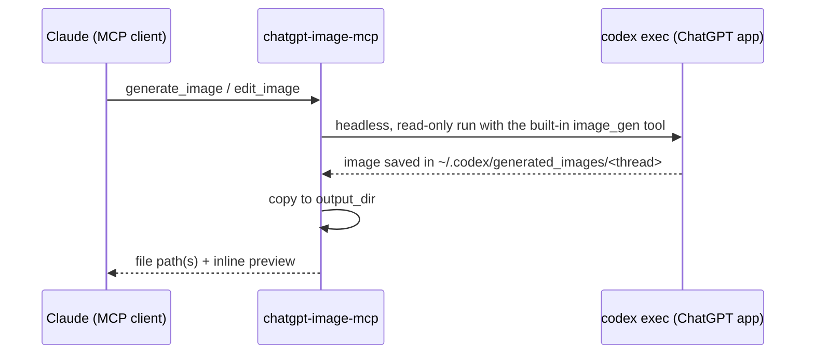

<div align="center">

# 🎨 chatgpt-image-mcp

**Let Claude generate and edit images with ChatGPT, using the ChatGPT app already on your computer.**
No API key and no extra billing: images are generated with your ChatGPT subscription.


</div>

---

| `generate_image` | `edit_image` |
|:---:|:---:|
|  |  |
| *"a cute minimalist flat illustration of a fox reading a book", landscape* | *"give the fox a small pair of round glasses"* |

## ✨ Features

- 🖼️ **Generate** images from a text prompt, optionally guided by reference images
- ✏️ **Edit** existing images (change backgrounds or colors, add or remove objects) without touching the original
- 🔑 **No API key**: uses the Codex CLI bundled with the ChatGPT desktop app, signed in with your ChatGPT account
- 👀 **Previews**: the client gets the image back inline, so Claude can look at the result and iterate
- 💾 **Saved to disk** wherever you want, with safe file names and no overwrites
- 🧩 Works with **Claude Code**, **Claude Desktop** and any other MCP client

## ⚙️ How it works



The ChatGPT desktop app for Windows (Microsoft Store package `OpenAI.Codex`) ships the `codex` CLI.
That CLI is already signed in with your ChatGPT account and can generate images with its built-in
`image_gen` tool. For each request, this server runs `codex exec` in the background with a
locked-down configuration:

- `--sandbox read-only` and `--ignore-user-config`, so it can't run commands and loads none of your personal plugins
- `--ephemeral`, so it leaves no chat history behind

The server then collects the resulting image from `~/.codex/generated_images/`.

## 📋 Requirements

- **ChatGPT desktop app** (Codex) installed, and signed in with a ChatGPT account that includes image generation.
  Check it with `codex login status`, which should print *"Logged in using ChatGPT"*.
- **Node.js 18+**

> On macOS and Linux it should work with the standalone Codex CLI (`npm i -g @openai/codex`, then `codex login`) available on your `PATH`. This hasn't been tested yet, so feedback is welcome.

## 🚀 Installation

```bash
git clone https://github.com/carellice/chatgpt-image-mcp.git
cd chatgpt-image-mcp
npm install
```

### Claude Code

```bash
claude mcp add chatgpt-image -s user -- node "/absolute/path/to/chatgpt-image-mcp/index.js"
```

`-s user` makes it available in every project. Start a new session and it's ready.

### Claude Desktop

Add this to `claude_desktop_config.json`:

```json
{
  "mcpServers": {
    "chatgpt-image": {
      "command": "node",
      "args": ["C:/absolute/path/to/chatgpt-image-mcp/index.js"]
    }
  }
}
```

You don't need to start the server yourself: the MCP client launches it when a session starts and stops it when the session ends.

## 💬 Usage

Just ask in plain language:

> *Generate a landscape hero image for the homepage: minimal, warm tones, a desk with a laptop and a plant.*

> *Create a coffee cup icon with a transparent background and save it in `public/icons`.*

> *Edit `assets/logo.png` so the background is navy blue, keep everything else identical.*

> *Give me 3 variants of a blog cover about remote work.*

Each image takes roughly **30–90 seconds**.

## 🛠️ Tools

### `generate_image`

| Parameter | Type | Default | Description |
|---|---|---|---|
| `prompt` | string | **required** | Detailed description of the image |
| `reference_images` | string[] | `[]` | Absolute paths of up to 10 images to use as style or composition references |
| `orientation` | `auto` \| `square` \| `landscape` \| `portrait` | `auto` | Aspect ratio |
| `transparent` | boolean | `false` | Transparent background (PNG with alpha) |
| `n` | 1–4 | `1` | Number of variants |
| `output_dir` | string | `~/Pictures/chatgpt-images` | Where to save the files |
| `filename` | string | timestamp | Base file name, without extension |
| `include_preview` | boolean | `true` | Return the image inline to the client |

### `edit_image`

Accepts the same optional parameters, plus:

| Parameter | Type | Description |
|---|---|---|
| `prompt` | string | **required.** What to change, and what must stay the same |
| `image_path` | string | **required.** Absolute path of the image to edit (png, jpg or webp) |
| `extra_images` | string[] | Up to 9 supporting images, such as a logo or an object to insert |

## 🔧 Configuration

Every setting is optional and is set through environment variables (in the `env` block of your MCP config).

| Variable | Default | Description |
|---|---|---|
| `CHATGPT_IMAGE_OUTPUT_DIR` | `~/Pictures/chatgpt-images` | Default output directory |
| `CODEX_PATH` | auto-detected | Path to the `codex` executable |
| `CODEX_HOME` | `~/.codex` | Codex home directory |
| `CODEX_MODEL` | Codex default | Model that orchestrates the `image_gen` call |
| `CHATGPT_IMAGE_TIMEOUT_MS` | `600000` | Timeout for each call |

## 🩺 Troubleshooting

| Problem | Fix |
|---|---|
| `Codex CLI not found` | Install or update the ChatGPT desktop app, or set `CODEX_PATH`. On Windows the app path changes with every update; the server finds it again on each start through `Get-AppxPackage OpenAI.Codex`. |
| `No image was generated` | Run `codex login status`. Your plan's image limit may have been reached, or the prompt may have been refused by content policies. |
| The tool doesn't show up | Start a **new** session. Check `claude mcp get chatgpt-image`. |
| Previews are missing | Images over ~3.5 MB aren't sent inline, but they are still saved to disk. |

## ⚠️ Notes and limitations

- This project relies on how the Codex CLI behaves today: `codex exec --json`, the built-in `image_gen` tool and the `generated_images` folder. A future Codex update could change any of these.
- Usage counts against your ChatGPT plan's limits, and each call also uses some Codex tokens (roughly 30k–100k input tokens).
- Only orientation can be controlled, not exact pixel sizes. Codex picks the resolution.
- The original files in `~/.codex/generated_images/` are kept. Delete them yourself if you need the space.

## 📄 License

[MIT](LICENSE)

---

<sub>This is an unofficial community project. It is not affiliated with or endorsed by OpenAI or Anthropic. ChatGPT and Codex are trademarks of OpenAI.</sub>
